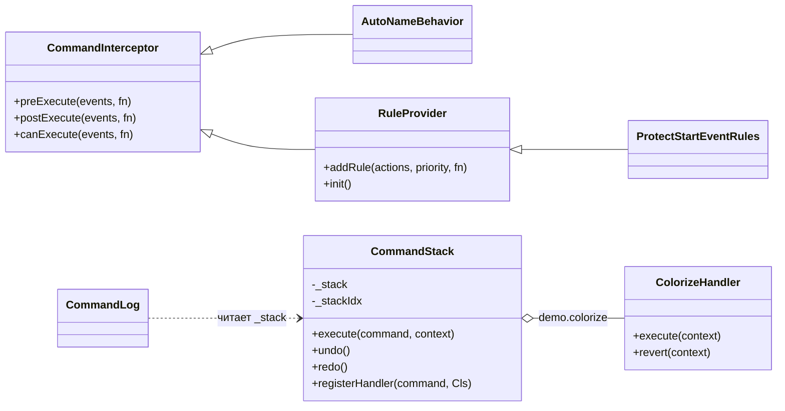

# Демо: стек команд (CommandStack) в bpmn-js

Демо-проект к итоговому заданию «Исследование архитектуры библиотеки».

| | |
|---|---|
| **Автор** | Фомин Павел Андреевич |
| **Стек** | Системная аналитика |
| **Библиотека** | [bpmn-js](https://github.com/bpmn-io/bpmn-js), версия **18.31.1** ([тег v18.31.1](https://github.com/bpmn-io/bpmn-js/tree/v18.31.1)) |
| **Ядро** | [diagram-js](https://github.com/bpmn-io/diagram-js), версия **15.28.1** ([тег v15.28.1](https://github.com/bpmn-io/diagram-js/tree/v15.28.1)) — в нём лежит сам `CommandStack` |
| **Исследуемый механизм** | выполнение команд с undo/redo, группировка вложенных команд, перехват через `CommandInterceptor` и `EventBus`, правила |

Версии зафиксированы в `package.json` точно (без `^`). Для diagram-js стоит ещё и `overrides`, чтобы bpmn-js не подтянул другую версию.

## Запуск

Нужен Node.js 18 или новее.

```bash
npm install
npm run dev
```

Откройте адрес, который покажет Vite (обычно http://localhost:5173).

Сборка статической версии: `npm run build`, результат появится в `dist/`.

## Что на экране

- **Холст bpmn-js** с процессом: «Заявка получена» → «Проверить заявку» → «Заявка обработана».
- **Стек команд** (справа): содержимое `commandStack._stack`, указатель `_stackIdx` и `id` каждой записи. Записи одной группы (один `id`) окрашены одинаково. Отменённые записи зачёркнуты.
- **События последнего действия**: трасса фаз `preExecute → execute → executed → postExecute` (или `revert → reverted`). Отступ показывает вложенность команд.
- **Строка статуса**: какой вызов API сделала кнопка.

## Сценарии

### 1. Удаление задачи (диаграмма последовательности «Удаление задачи»)
Нажмите **«Удалить «Проверить заявку»»**. Кнопка вызывает `modeling.removeShape(task)`.

Что увидите в журнале: одна корневая команда `shape.delete` и вложенные команды с тем же `id`:
- `connection.reconnect` и `connection.layout` от **RemoveElementBehavior**: поток от старта переподключается к концу;
- `id.updateClaim` от **UnclaimIdBehavior**: освобождаются id;
- `connection.delete` из `DeleteShapeHandler.preExecute`: удаляется оставшаяся стрелка;
- `lane.updateRefs` и `group.updateRefs` от поведений, которые обновляют ссылки дорожек и групп.

### 2. Отмена (диаграмма последовательности «Ctrl+Z»)
Нажмите **Undo** или щёлкните по пустому месту холста и нажмите **Ctrl+Z**. Вся группа откатится за один шаг, в обратном порядке, через `revert`.

**Redo** повторит группу без фаз `preExecute`/`postExecute`: вложенные команды уже лежат в стеке, и их не нужно создавать заново.

### 3. Свой перехватчик: `AutoNameBehavior`
Нажмите **«+ Задача»**. В фазе `postExecute` команды `shape.create` перехватчик даёт задаче имя «Задача N». Имя выставляется вложенной командой `element.updateLabel`, поэтому один Undo убирает и имя, и саму задачу.

### 4. Своя команда: `demo.colorize`
Выделите фигуру и нажмите **«Покрасить выделенное»**. Это `commandStack.execute('demo.colorize', …)`. Обработчик `ColorizeHandler` реализует `execute`/`revert` и сохраняет старый цвет в контексте. Undo вернёт прежний цвет.

### 5. Правило и его обход: `ProtectStartEventRules`
- Выделите стартовое событие. В его контекстном меню нет корзины, а клавиша Delete и кнопка **«Удалить выделенное (через правила)»** ничего не удаляют: `rules.allowed('elements.delete')` возвращает `false`.
- Нажмите **«Удалить старт из кода»**. Это прямой `modeling.removeShape(start)`, и он удаляет старт.

Причина: `CommandStack.execute()` не вызывает `canExecute`. Правила проверяет только вызывающий код, то есть UI-пути `EditorActions` и `ContextPadProvider`.

## Структура проекта

```
src/
  main.js                     точка входа Vite: стили + XML + start()
  app.js                      создание BpmnModeler и кнопки
  diagram.bpmn                исходная диаграмма
  style.css
  demo/
    index.js                  модуль didi (подключается через additionalModules)
    CommandLog.js             панель стека и трассы событий
    AutoNameBehavior.js       CommandInterceptor (postExecute shape.create)
    ProtectStartEventRules.js RuleProvider (canExecute elements.delete)
    ColorizeHandler.js        CommandHandler своей команды demo.colorize
```



Классы демо выделены отдельно, базовые классы взяты из diagram-js.

## Где ставить точки останова

Откройте DevTools → Sources, нажмите Ctrl+P и введите имя файла. Vite собирает зависимости с source maps, поэтому в DevTools видны исходные файлы из `node_modules`.

| Файл (diagram-js / bpmn-js) | Метод | Что увидеть |
|---|---|---|
| `diagram-js/lib/command/CommandStack.js` | `execute` (стр. 176) | вход любой команды |
| там же | `_internalExecute` (стр. 422) | порядок фаз, `_atomicDo` |
| там же | `_pushAction` (стр. 475) | как вложенная команда получает `id` корневой |
| там же | `undo` (стр. 253) | цикл `while` по одинаковому `id` |
| `diagram-js/lib/command/CommandInterceptor.js` | `on` (стр. 72) | склейка имени события `commandStack.<cmd>.<фаза>` |
| `bpmn-js/lib/features/modeling/behavior/RemoveElementBehavior.js` | `preExecute('shape.delete')` (стр. 29) | переподключение потока |
| `src/demo/*.js` | любой | свой код демо |

Для экспериментов в консоли доступен `window.modeler`. Например: `modeler.get('commandStack')._stack`.
